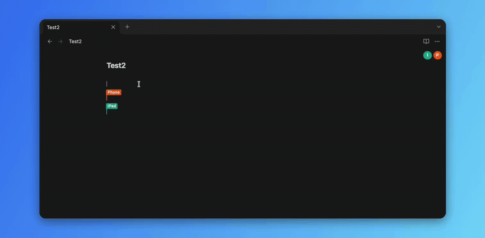
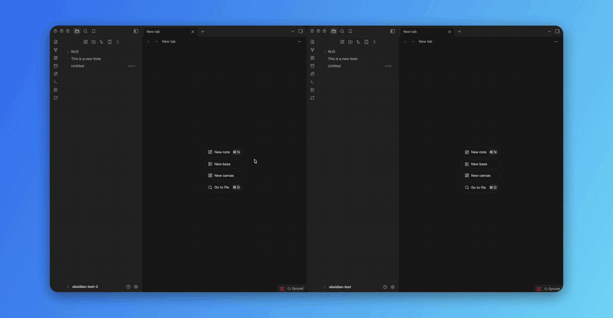

# <div align="center">SupaBase Jump for Obsidian</div>

<div align="center">
Sync your Obsidian vault with your own Supabase project. Edit the same note on two devices at once and watch the changes show up as you type, a bit like Google Docs.
</div>

<br />

<div align="center">

**Note:** this is an unofficial way to sync and back up your notes. [Obsidian Sync](https://obsidian.md/sync) is the official option.

</div>

<div align="center">
  <a href="https://github.com/brianstm/obsidian-supabase-jump/releases">
    
  </a>
</div>

## Demo

**One note, three devices.** A Mac, an iPad and a phone editing together, each with its own cursor.



> If the video looks blurry, you can [download it here](assets/video-demo-devices.mp4).

**Side by side.** Two windows of the same vault syncing as you type.



> If the video looks blurry, you can [download it here](assets/video-demo.mp4).

## What it does

- **Live editing.** Open the same note on your laptop and your phone and type on either one. Changes appear on the other device right away, with colored cursors and a small badge showing who else is in the note.
- **Real time sync.** Every change you save is sent to Supabase and pushed to your other devices within a second or two.
- **Works on phones.** When your phone goes to sleep or you switch apps, the plugin reconnects and catches up as soon as you come back.
- **Works offline.** Edits made without a connection are kept and uploaded when you are back online. Deletes and renames made while offline are handled too.
- **Never loses a version.** If a note was changed on two devices before they could sync, both versions are kept and the other one is saved next to it as a conflict copy.
- **Version history.** Every note keeps up to 50 older versions in your database. Open the history, preview an old version, and restore it with one click.
- **Restore deleted notes.** Bring back notes you deleted on any device.
- **Attachments.** Images, PDFs and other files go to Supabase Storage. Renaming a big file just moves it instead of uploading it again.
- **Settings sync.** Your themes, snippets, hotkeys and plugins can follow you to every device, and you can choose which ones stay different on mobile and desktop.
- **Queryable notes.** Frontmatter and tags are stored in their own columns so you can query your notes with SQL.
- **Your data, your project.** Everything lives in your own Supabase project, protected by row level security.
- **Self-host friendly.** Run Supabase on your own server, Mac, Windows PC, Raspberry Pi or NAS. See the [self-hosting guide](SELF_HOSTING.md).

## Getting started

### 1. Create a Supabase project

You have two choices:

- **Hosted (easiest):** sign up at [supabase.com](https://supabase.com) and create a new project. The free plan is fine. Then open **Project settings → API** and keep the **Project URL** and the **anon public key** handy.
- **Self-hosted:** run Supabase yourself with Docker. The [self-hosting guide](SELF_HOSTING.md) covers Linux, macOS, Windows, Raspberry Pi and NAS, plus how to reach it from your phone over HTTPS.

### 2. Install the plugin

Install **SupaBase Jump** from **Settings → Community plugins → Browse** in Obsidian, then turn it on.

You can also install it by hand: download `main.js`, `manifest.json` and `styles.css` from the [latest release](https://github.com/brianstm/obsidian-supabase-jump/releases), put them in `<your vault>/.obsidian/plugins/supabase-jump/`, then reload Obsidian.

### 3. Set up your database

1. Create a personal access token at [supabase.com/dashboard/account/tokens](https://supabase.com/dashboard/account/tokens).
2. In **Settings → SupaBase Jump → Database setup**, add the token and press **Run setup**.

The setup is safe to run again. Do it once after every plugin update that mentions database changes, like this one.

Self-hosting, or don't want to create a token? Press **Copy SQL** and run it in the SQL editor of your project instead. The [self-hosting guide](SELF_HOSTING.md#step-6-set-up-the-database) shows where.

### 4. Connect

1. Fill in the project URL, anon key, email and password. The password is kept in Obsidian's secret storage on your device.
2. Pick a **Vault ID**. Use the same one on every device that should share this vault.
3. Press **Connect**.

That's it. On your other devices, install the plugin, use the same details and the same vault ID, and press connect.

## Using it

### The status bar

The status bar at the bottom shows what is going on: synced, syncing, offline, or live with other devices. Click it for quick actions like sync now, version history and restoring deleted notes. On mobile, use the ribbon button instead.

### Live editing

When a note is open on more than one device, the devices talk to each other directly through Supabase Realtime. Each keystroke is merged with [Yjs](https://github.com/yjs/yjs), so you can both type at the same time without overwriting each other. Turn off cursors or presence badges in settings if you find them distracting.

### Conflicts

If a note was changed on two devices while they couldn't reach each other, you'll get a copy named like `My note (conflict iPhone 2026-11-20 1405).md`. Look through both, keep what you need, and delete the copy. If you'd rather keep only the newest version, change **When a note changed on two devices** in settings.

### Version history

Run **Show version history of this note** from the command palette, or right click a note and pick **Version history**. A snapshot is saved when you start editing a note after a 10 minute break, so you get a version for every editing session without flooding your database.

### Commands

- **Sync now** compares everything and fixes anything that is out of date
- **Check for changes** grabs the latest changes from the cloud
- **Show version history of this note**
- **Restore a deleted note**
- **Show sync status**
- **Reconnect**
- **Copy database setup SQL**

### Keeping some settings separate per device type

Under **Obsidian settings folder → Keep separate for phone and computer**, pick things like your theme or hotkeys that should stay different on mobile and desktop. Your open tabs and layout are not synced by default, so switching devices won't move your tabs around.

## Self-hosting

Everything the plugin needs (Postgres, Auth, Storage and Realtime) is part of the standard self-hosted Supabase setup. On a small server or Raspberry Pi, the [lite setup](SELF_HOSTING.md#lite-setup-for-small-servers-optional) skips the parts the plugin doesn't use and idles at around 800 MB of RAM. The short version:

1. Install Docker.
2. Clone the Supabase repo, copy the `docker` folder, change the secrets in `.env`, and run `docker compose up -d`.
3. Set `ENABLE_EMAIL_AUTOCONFIRM=true` so you can sign in without an email server.
4. Give it an `https://` address with Tailscale, Cloudflare Tunnel or Caddy so your phone can reach it.
5. Run the setup SQL in Studio and connect the plugin with your server address and `ANON_KEY`.

The [self-hosting guide](SELF_HOSTING.md) walks through each step for every platform, plus backups, updates and common problems.

## How it works

- Text files are stored in the `vault_files` table, one row per file.
- Attachments are stored in the private `vault-attachments` storage bucket.
- Each device keeps a small index of what it last synced, so it can tell a real edit apart from a file that only had its timestamp touched. That is what makes deletes, renames and conflicts safe.
- Changes from other devices arrive through Supabase Realtime. If that connection drops, the plugin checks for changes every 20 seconds until it is back.
- Live editing uses private Realtime channels that only your account can join.

### Database columns

| Column                    | What it holds                                   |
| ------------------------- | ----------------------------------------------- |
| `id`                      | `{vaultId}::{path}` with slashes as `__SLASH__` |
| `vault_id`                | The vault ID from settings                      |
| `path`                    | Path of the file inside the vault               |
| `content`                 | Text of the file (text files only)              |
| `storage_path`            | Where the attachment lives in storage           |
| `frontmatter`             | All frontmatter properties as JSON              |
| `tags`                    | Tags from frontmatter                           |
| `platform`                | `all`, `mobile` or `desktop`                    |
| `mtime`, `ctime`, `size`  | File details                                    |
| `deleted`                 | Set when the file is deleted                    |
| `device_id`, `device_name`| Which device saved it last                      |
| `updated_at`              | Set by the database on every change             |
| `user_id`                 | Owner, used by row level security               |

Old versions live in `vault_file_versions`.

### Querying your notes

```sql
-- Notes tagged "book"
select path, frontmatter->>'title', tags
from vault_files
where 'book' = any(tags) and deleted = false;

-- Notes that aren't done yet
select path, frontmatter->>'status'
from vault_files
where frontmatter->>'status' != 'done' and deleted = false;

-- How many notes use each tag
select tag, count(*)
from vault_files, unnest(tags) as tag
where deleted = false
group by tag order by count desc;
```

## Troubleshooting

**Setup failed.** Check that the personal access token is correct and belongs to the account that owns the project. For self-hosted projects, use **Copy SQL** instead.

**Self-hosted and something isn't working.** The [self-hosting guide](SELF_HOSTING.md#troubleshooting) has a troubleshooting section for connection, HTTPS, websocket and upload problems.

**Email not confirmed.** Click the link Supabase emailed you and press connect again. You can also turn off email confirmation in Supabase under **Authentication → Providers → Email**.

**A message says the database is missing new columns.** Run the setup again. Your notes are not touched, it only adds what is missing.

**Files are not syncing.**

1. Look at the status bar. It should say Synced.
2. Make sure the vault ID is the same on both devices.
3. Make sure the file isn't inside a skipped folder or bigger than the size limit.
4. Run **Sync now** and check the developer console (Ctrl+Shift+I or Cmd+Option+I) for errors.

**Live editing isn't working.** Both devices need to be connected and have the same note open. If you set up your database before version 1.2.0, run the setup again so private live channels are allowed.

## Privacy and security

- Your notes are stored in your own Supabase project, not on anyone else's server.
- Row level security makes sure only your account can read or change your files.
- Your password and access token are kept in Obsidian's secret storage, not in the plugin's data file.
- Live editing messages go through private channels limited to your account and are never saved.
- No tracking or analytics of any kind.

## Development

```bash
git clone https://github.com/brianstm/obsidian-supabase-jump.git
cd obsidian-supabase-jump
npm install
npm run dev
```

Run `npm run lint` and `npm run build` before opening a pull request. See [CONTRIBUTING.md](CONTRIBUTING.md) for more.

```
src/
├── main.ts           plugin setup, commands and events
├── settings.ts       settings and path rules
├── settings-tab.ts   settings screen
├── supabase.ts       sign in and connection handling
├── sync.ts           file sync engine
├── sync-state.ts     per-device sync index
├── schema.ts         database setup SQL
├── history.ts        version history and restore screens
├── status.ts         status bar
├── frontmatter.ts    frontmatter parser
└── live/             live editing (Yjs, cursors, presence)
```

## License

MIT, see [LICENSE](LICENSE).

## Support

Found a bug or have an idea? Open an issue on [GitHub](https://github.com/brianstm/obsidian-supabase-jump/issues).

## Thanks

Built with the [Obsidian API](https://docs.obsidian.md), [Supabase](https://supabase.com) and [Yjs](https://github.com/yjs/yjs).
